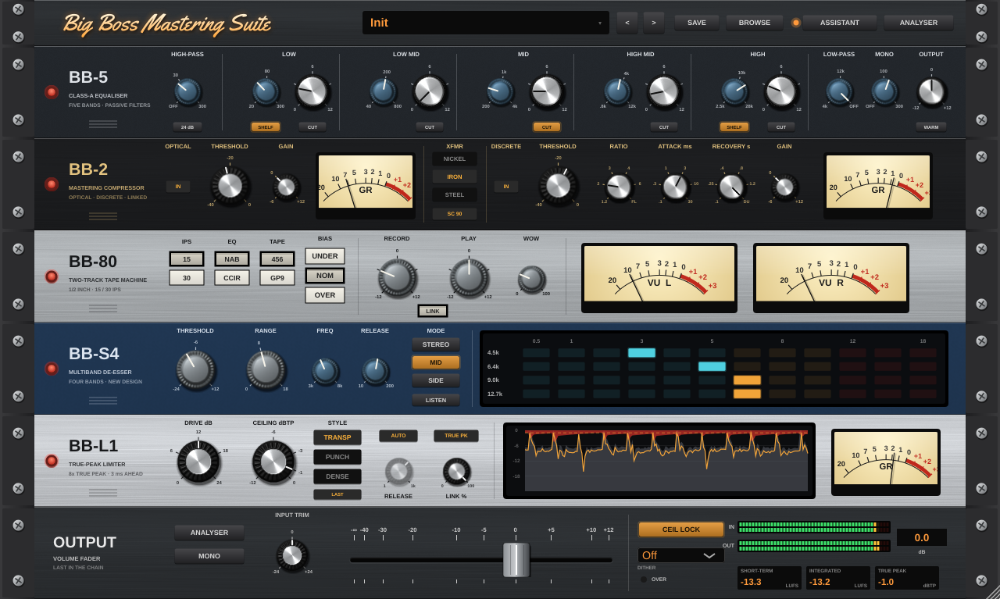
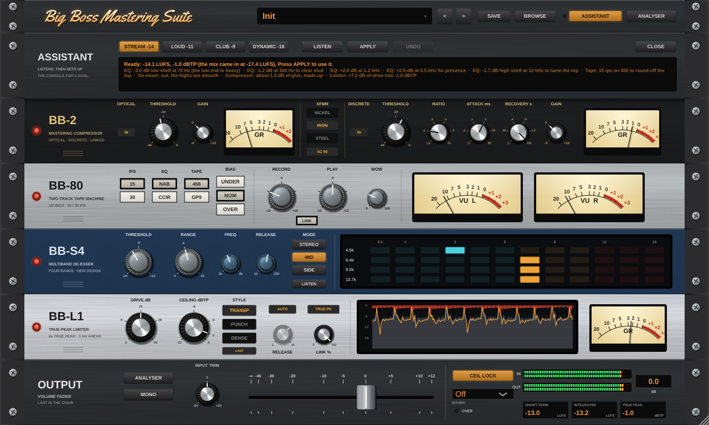
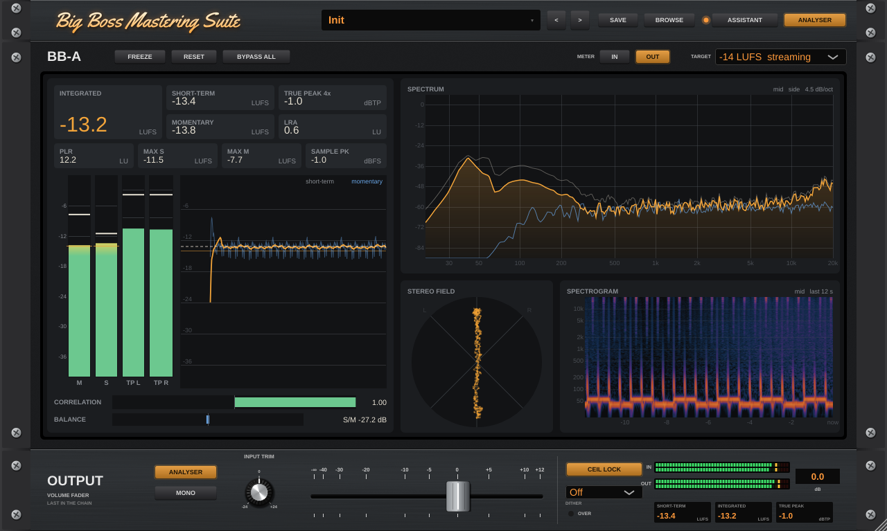

# Big Boss Mastering Console

A mastering console as one VST3: detailed loudness and level metering, and a chain modelled on mastering hardware rather than on other plugins.

The console is a rack, in the manner of the owner's Vocal Chain plugin: the half-height **Big Boss Mastering Suite** master section (presets, and keys for the assistant and the analyser) on top, one 1U faceplate per module in chain order, and the **OUTPUT** unit with the volume fader at the bottom. Press **ANALYSER** (on the master section or on the output unit) and a 5U analyser (loudness, true peak, spectrum, spectrogram, stereo field) takes the modules' place; press it again to go back.

- **Drag a module by its name plate** to move it in the chain. The others close up around it.
- **Click the lamp** at the left of a faceplate to bypass that module.
- **Resize by dragging** the corner (or the host window's edge): the whole rack scales as one, from 50% to 200%, and keeps its shape. If a host gives the window a different shape, the rack shrinks to fit and is centred, so no unit is ever cut off. It opens at 75% (960 × 620), which fits a 1080p screen at 125% display scaling.
- **The analyser's own keys**: **FREEZE** holds every display, **RESET** restarts integrated loudness, LRA, the peak holds and the spectrogram, and **BYPASS ALL** takes the whole console out (trim and fader too; the output is the untouched input, time-aligned) while the meters keep running, for a straight before-and-after. It fades over 10 ms, isn't saved with the session, and the output unit says ALL BYPASSED while it is on. **IN**/**OUT** pick what the analyser measures, and **TARGET** sets the reference line.
- **The fader** sets the output level, from off to +12 dB, with IN and OUT peak meters and short-term, integrated and true-peak readouts beside it. **INPUT TRIM** sits next to it (±24 dB) and acts before the chain. **MONO** sums the output to mono after the fader (a 10 ms fade either way) to check how the master holds up on one speaker; it is a parameter, so it is saved and it affects a render: switch it off before you bounce.
- **CEIL LOCK** (on by default) is a last true-peak guard at the limiter's ceiling, after the fader and MONO, so nothing leaves the console above the ceiling whatever the fader or the module order. Below the ceiling it does nothing. The **OVER** lamp under it lights amber while the lock is catching (pull the fader down) and red if the output goes over the ceiling with the lock off.
- **DITHER**: OFF, 24-bit, 16-bit or 16-bit shaped. TPDF dither to that word length, last of all; the shaped setting moves the noise up toward 20 kHz, where it is hardest to hear. Use it when you bounce to that word length, and leave it OFF for a 32-bit float file.

## Presets and the assistant

**Presets.** Ten factory presets (Init, Gentle Polish, Streaming Master, Loud & Punchy, Warm Tape Glue, Vocal Forward, Low End Control, Bright & Airy, Club Master, Transparent) and your own. Step through them with the arrows, or click the display or **BROWSE** for the list. **SAVE** stores every setting and the module order under a name you choose, as a `.bbpreset` file in your user app-data folder (`%APPDATA%\Big Boss Mastering Console\Presets` on Windows); the menu opens that folder. The factory presets are also the host's program list. A preset never touches INPUT TRIM, the fader, MONO, CEIL LOCK, DITHER or the limiter's LAST key: those belong to the session.

**The assistant**, for when you don't know where to start. Press **ASSISTANT** on the master section and it drops down over the rack (**CLOSE** folds it away; it keeps listening or working, and a lamp by the key lights while it is busy or has a suggestion waiting). Pick a goal (**STREAM** −14 LUFS, **LOUD** −11, **CLUB** −9, **DYNAMIC** −16), play the loudest part of the mix and press **LISTEN**. It takes 10 seconds of audio (pauses don't count), then:

- measures loudness, peak-to-loudness ratio, the tonal balance against a reference for mastered music (low end, low mids, mids, presence, air), how much the 5–10 kHz band dominates its loudest moments (sibilance), and how wide the bass is;
- picks settings a mastering engineer might start from: half the EQ it would take to reach the reference (at most 3 dB, nothing under 0.75 dB), a 25 Hz high-pass and mono bass if the low end is wide, the darker or the cleaner tape, the de-esser only when "s" sounds stand out, and the compressor out if the mix is already dense;
- renders what it heard through a private copy of the chain to check them: the compressor's thresholds move until it does 1 to 2.5 dB of work (by goal), made up so it doesn't change loudness, and the limiter's drive moves until the result lands on the goal. A mix that arrives louder than the goal is turned down at the input trim instead.

The display shows the result and every change with its reason. Nothing changes until **APPLY**, and **UNDO** puts back what you had.







## Plan

| Step | What | State |
|---|---|---|
| 1 | Foundation and metering: project, chain host, meters | done |
| 2 | Elysia museq-style mastering parametric, filters, Studer A80 tape; rack tabs | done |
| 3 | Shadow Hills-style mastering compressor; our own limiter, scored against FabFilter Pro-L 2 | done |
| 4 | A new multiband de-esser; the full console UI | done |
| 5 | The rack UI from Vocal Chain: 1U units, output fader, analyser unit, drag to resize | done |
| 6 | Presets, the assistant that sets the console up for a mix; the analyser's spectrogram, FREEZE and BYPASS ALL | done |
| 7 | Full review: the technical spec ([docs/SPEC.md](docs/SPEC.md)) and the roadmap ([docs/ROADMAP.md](docs/ROADMAP.md)) | done |

What comes next, in order, is in [docs/ROADMAP.md](docs/ROADMAP.md): Phase A (the safety fixes), dither and the flux-modelled transformers are done; next are level-matched compare and A/B slots, and the side-by-side test against Pro-L 2.

None of the hardware has public schematics, so the models are voiced from published specs, manuals and measurements of the units. Each module's notes will say which.

## The chain

Five slots: **Parametric EQ, Compressor, Tape, De-esser, Limiter**. Drag a module by its name plate to reorder it, click its lamp to bypass it. All five are built.

- **Latency never changes.** It is the sum of every module's latency, whatever is bypassed or reordered, so the host's delay compensation stays put. A bypassed module's dry path is delayed by the same amount.
- **Bypass is a 10 ms crossfade**, and bypassed modules keep running, so switching one back in is seamless.
- **Reordering dips for about 30 ms** rather than glitching: a 10 ms raised-cosine fade out, the switch, a hold while the old audio clears and the modules settle on their new inputs, and a 10 ms fade in.
- **Input trim** (±24 dB) sits before the chain and the **volume fader** (off to +12 dB) after it.
- The host's own bypass delays the dry signal by the chain's latency, so A/B against the host bypass stays time-aligned.

## Class-A EQ

Five bands in the manner of the elysia museq. Each gain knob goes one way (0 to 12 dB) and its **BOOST/CUT** switch gives it a direction and a shape: boosts are broad and gentle, cuts narrower, as on the hardware. LOW and HIGH switch between **SHELF** and **BELL**.

| Band | Range | Default |
|---|---|---|
| LOW | 20–300 Hz | 60 Hz, shelf |
| LOW MID | 40–800 Hz | 200 Hz |
| MID | 200 Hz–4 kHz | 1 kHz |
| HIGH MID | 800 Hz–12 kHz | 4 kHz |
| HIGH | 2.5–28 kHz | 12 kHz, shelf |

- **HIGH-PASS** 10–300 Hz at 12 or 24 dB/oct, **LOW-PASS** 4–30 kHz at 12 dB/oct, and **MONO BASS** 40–300 Hz, which high-passes only the side signal (24 dB/oct). Each has an OFF position at the end of its travel.
- **WARM** broadens the boosts a little and adds the class-A stage's low-order harmonics (mostly 2nd, about 0.1% at 0 VU and rising with level).
- Everything runs oversampled to 176.4 kHz or more, so bells and shelves keep their analogue shape up to 20 kHz. Knobs glide over 20 ms; a switch fades its band to 0 dB, changes shape and fades back, so nothing clicks.
- The phosphor scope draws the response from the same filter design the audio runs; the audio matches the drawn curve within 0.1 dB.

## Tape machine

A two-track mastering recorder in the manner of the Studer A80.

- **SPEED** 15 or 30 ips. **EQUALIZATION** NAB or CCIR at 15 ips; 30 ips is always AES.
- **TAPE**: a 456-type formulation (MOL +8 dB over 0 VU) or a GP9-type (+12 dB). **BIAS**: under (hotter, brighter), nominal, or over (cleaner, darker).
- **INPUT** sets the record level: 0 dB puts −18 dBFS RMS at 0 VU. **LINK** makes **OUTPUT** follow input inversely, so INPUT changes the drive but not the level.
- **WOW & FLUTTER**, 0–100% of the A80's specified maximum (default 25%).
- Signal path: record pre-emphasis, Jiles–Atherton tape hysteresis and its exact de-emphasis (all oversampled), then the playback head's response (head bump, low-end roll-off, gap loss and bias's HF tilt) and the transport. The drive is calibrated so 3% THD at 1 kHz falls at each tape's MOL; at 0 VU the 456 reads about 0.55% THD and the GP9 about 0.25%. Switch changes crossfade between two fully threaded paths over 30 ms.
- The VU meters show record level with VU ballistics.

The responses are voiced from published A80 specifications and plots, not measured from a machine.

## Compressor

A two-stage stereo mastering compressor in the manner of the Shadow Hills Mastering Compressor. Both stages are always stereo-linked.

- **OPTICAL**: threshold and gain. It is a gentle, wide-kneed stage, about 3:1 well above threshold, and its release depends on its history like a photocell's. It lets go of a short burst in about 60 ms, but after it has been held down for a while the release slows toward 1.5 s.
- **DISCRETE**: threshold and gain. It is fed from the optical stage's output and has these selectors:
  - **RATIO**: 1.2:1, 2:1, 3:1, 4:1, 6:1 or FLOOD.
  - **ATTACK**: 0.1 to 30 ms, in six steps.
  - **RECOVERY**: 0.1 to 1.2 s, or DUAL. DUAL recovers fast from peaks and slowly from sustained compression.
- **OUTPUT TRANSFORMER**: modelled on the core's flux, as real iron is, so loud lows round off and thicken while the mids and highs pass almost untouched, and the distortion rises about 6 dB per octave as the frequency falls. NICKEL is close to a wire (0.12% THD at 50 Hz, −6 dBFS). IRON's core is biased, so it adds mostly 2nd harmonic (1.3%). STEEL saturates hardest and adds mostly 3rd harmonic and weight (2.4%). Quiet passages stay clean on all three.
- **SIDECHAIN HIGH-PASS** at 90 Hz, so the kick and bass do not drive the compression.
- Each stage has its own gain-reduction meter.

The behaviour is voiced from the unit's manual and published descriptions, not measured from one.

## Limiter

Our own design: a true-peak mastering limiter.

- **DRIVE** 0 to 24 dB into a **CEILING** of 0 to −12 dBTP.
- **TRUE PEAK** detection reconstructs the signal at 8x below 88.2 kHz (4x below 176.4 kHz, 2x above) with a 32-tap-per-phase sinc, and refines each crest with a parabola. Overs between samples are therefore caught before they happen, and the ceiling holds after any D/A or codec. **SAMPLE** mode limits sample peaks only.
- The gain can never let an over through. It comes from the minimum required gain over a 3 ms lookahead, then a hold and a two-speed release, then one or two moving averages no longer than the lookahead. Every stage can only lower the gain, so the result is at or below the required gain at every sample.
- The hold spans a bass note's half cycle, so a sustained low note gets a steady gain instead of one that ripples at the note's frequency. A ripple like that is the usual cause of a limiter's low-frequency distortion.
- **STYLE**: TRANSPARENT (smooth S-curve attack, long hold and release), PUNCH, or DENSE (short hold, fast release, louder). Switching style crossfades the gains, which is safe because every style's gain is under the required gain.
- **RELEASE**: AUTO (two-speed and programme dependent), or MANUAL from 1 ms to 1 s. **STEREO LINK** from 0 to 100%.
- **LAST** (on by default) keeps the limiter at the end of the chain whatever order the modules are dragged into. Switch it off to put a module after it.
- Latency is 3 ms plus 16 samples. Below the ceiling it is a pure delay, bit for bit.
- The display shows six seconds of input, output and gain reduction, next to a gain-reduction meter.

Measured here, with the −1 dBTP ceiling and 6 dB of reduction on a steady sine (THD+N, 48 kHz, from `bb_dynamics_tests`):

| Style | 30 Hz | 50 Hz | 100 Hz | 1 kHz |
|---|---|---|---|---|
| Transparent | <0.0001% | <0.0001% | <0.0001% | <0.0001% |
| Punch | 0.10% | <0.0001% | <0.0001% | <0.0001% |
| Dense | 1.06% | 0.11% | <0.0001% | <0.0001% |

True peak stays at or under the ceiling, within the meter's 0.05 dB, at every rate and style tested: on a hot programme driven 12 dB, on a 19 kHz tone, and while switching styles mid-limit. These are our own measurements; there has been no side-by-side test against Pro-L 2 here.

## De-esser

A design of our own, built to be transparent until it acts and to cut only where the "s" is.

- **Four bands**, half an octave apart from **FREQUENCY** (3 to 8 kHz) up: 4.5, 6.4, 9 and 12.7 kHz by default. Each band is a dynamic cut of the form `x − depth · bandpass(x)`. With nothing to do, depth is zero and the band is an exact wire, so the de-esser is a bit-exact delay until it acts.
- **Detection is relative to the voice.** Each band's energy is compared with the energy of the body (300 Hz to 3 kHz) at the same moment, so **THRESHOLD** is in dB of band over body (−24 to +12). The same "s" is caught the same way on a quiet verse and a limited chorus, and a bright but steady mix is not mistaken for sibilance. Below −60 dBFS nothing counts.
- **Focus.** A band counts only as far as it keeps up with the loudest band, so an "s" at 6 kHz is cut at 6 kHz and its spill into the 12.7 kHz air band is left alone.
- **Onsets are not sibilance.** The body detector rises as fast as the bands, so a vowel's start or a plosive lifts both together.
- **RANGE** (0 to 18 dB) is the most any band cuts, with a 3 dB soft knee. **RELEASE** 10 to 200 ms; the attack is 0.5 ms, and 1 ms of lookahead lets the cut arrive with the consonant instead of after it. Latency is 1 ms.
- **MODE**: MID (default, only the centre, where a vocal lives), STEREO (both channels, linked), or SIDE. **LISTEN** plays only what is being removed.
- Four LED ladders show each band's reduction, labelled with its centre.

## Metering

Switch the meters between **IN** (the signal arriving, before the input trim) and **OUT** (what leaves the console). **RESET** restarts integrated loudness, LRA, the maxima and the peak holds.

| Reading | How it is measured |
|---|---|
| Momentary, short-term, integrated | ITU-R BS.1770-4 / EBU R128: K-weighting re-derived for every sample rate, 400 ms and 3 s windows, absolute (−70 LUFS) and relative (−10 LU) gates |
| LRA | EBU Tech 3342: short-term values, −20 LU relative gate, 10th to 95th percentile |
| True peak | 4x oversampling below 88.2 kHz and 2x below 176.4 kHz, with a 32-tap-per-phase Kaiser sinc, and each crest refined with a parabola. Within 0.05 dB up to 20 kHz at 44.1 kHz; plain 4x under-reads a 20 kHz tone there by up to 0.2 dB |
| PLR | Highest true peak minus integrated loudness |
| Max S, Max M | Highest short-term and momentary since reset |
| Sample peak | Highest sample, since reset |
| Correlation, balance, S/M | Integrated over 300 ms, like a hardware correlation meter |
| Spectrum | Mid (amber, with a slow peak trace) and side (blue), 8192-point FFT, tilted 4.5 dB/oct around 1 kHz so pink noise reads flat |
| Stereo field | Goniometer with auto-gain: mono is vertical, out-of-phase is horizontal |
| History | Short-term (amber) and momentary (blue) over the last 60 s, with the integrated value dashed |

The target menu (−9 to −23 LUFS) only moves the reference line on the bars and the history. It never changes the audio.

The engine is real-time safe: nothing allocates or locks on the audio thread, gated loudness uses fixed 0.01 LU histograms (so an hour of programme costs the same as a second), and the editor reads atomics and lock-free rings.

## Known limitations

- **The host program list** (the factory presets) is checked in pluginval but not yet in Reaper: load a factory preset, tweak it, save the project and reopen it, and the tweak should still be there.
- **CEIL LOCK adds latency** (3 ms plus 16 samples) whether it is on or off, so switching it never moves anything in time.

## Building

CMake 3.22+ and a C++17 compiler. JUCE 8.0.15 is fetched automatically; to use a local checkout, add `-DFETCHCONTENT_SOURCE_DIR_JUCE=/path/to/JUCE`.

```sh
cmake -S . -B build -DCMAKE_BUILD_TYPE=Release
cmake --build build --config Release --parallel
ctest --test-dir build -C Release --output-on-failure
```

The VST3 lands in `build/BigBoss_artefacts/Release/VST3/`, next to a Standalone app.

Linux needs: `libasound2-dev libfreetype-dev libfontconfig1-dev libx11-dev libxcomposite-dev libxcursor-dev libxext-dev libxinerama-dev libxrandr-dev libxrender-dev libgl1-mesa-dev`.

### Tests

- `bb_engine_tests`: K-weighting against the BS.1770 coefficient table; EBU Tech 3341 cases 1–5 (M, S and I, gating) and 15–19 (true peak); Tech 3342 cases 1–4 (LRA), all at 44.1, 48, 96 and 192 kHz; the 20 kHz true-peak accuracy; block-size independence; correlation; the chain's latency, bypass and reorder behaviour; and the tape slot's reported latency, measured by cross-correlation.
- `bb_module_tests`: the EQ is flat when idle, its audio matches the drawn curve within 0.1 dB, boosts are broader than cuts, and the high-pass, mono bass, Warm's 2nd harmonic, click-free switching and reported latency all check out. The tape machine puts 3% THD at each tape's MOL, has unity small-signal gain, reports its true latency, distorts more on 456 than GP9 and more under-biased than over, holds more top end at 30 ips, has its head bump, keeps wow and flutter within spec, switches without clicks, and keeps level constant under Link. Each at several sample rates.
- `bb_dynamics_tests`: the compressor's static curve, attack ordering, the optical stage's history-dependent release, the transformers (distortion falling with frequency, IRON mostly 2nd harmonic and STEEL mostly 3rd, clean when quiet, switching without a step) and the sidechain filter. The limiter's ceiling (sample and true peak) on a driven programme at 44.1, 48 and 96 kHz in every style, a 19 kHz tone, style switching under load, bit-exact transparency below the ceiling, its reported latency and stereo link. It also prints the distortion table above.
- `bb_module_tests` also checks the dither (on the word's grid, TPDF at 0.5 LSB rms, independent channels, shaped noise moved up) and that bypassing the EQ fades without a dip at 15 kHz.
- `bb_deesser_tests`: the bands stay under the top of the audio band at 44.1 kHz and a MODE change fades without a jump. On a synthetic voice (a 180 Hz vowel with a band of noise for the "s"), the de-esser is bit-exact when idle in every mode, cuts a hot 6.4 kHz "s" by at least 4 dB in its own band and at least 3 dB less at 12.7 kHz, leaves the vowel within 0.1 dB, catches the same "s" 20 dB quieter within 1.5 dB, leaves a soft "s" alone, reports its true latency, and LISTEN is silent with nothing removed. At 44.1, 48 and 96 kHz.
- `bb_module_tests` also reorders the full chain, every module working, on two low tones, and checks that the high-frequency residue around the switch is no more than the steady sound's (a click would show far above it).
- `bb_assist_tests`: on synthetic mixes, the assistant lands every goal within 0.5 LU with true peak under the ceiling, compresses by 0.5 to 3.5 dB, adds air to a dull mix, cuts a muddy one at 300 Hz, brings the de-esser in for a sibilant one and leaves it out otherwise, monos wide bass, and trims a mix that is already too loud.
- `bb_fuzz [seconds]`: random rates, block sizes, extreme signals, bypass and order changes, and random EQ, compressor, tape, de-esser and limiter settings through the chain and both meter suites; fails on any non-finite value.
- pluginval at strictness 10: `pluginval --strictness-level 10 --validate-in-process "build/BigBoss_artefacts/Release/VST3/Big Boss Mastering Console.vst3"` (on Linux, under `xvfb-run -a`).
- `bb_plugin_tests` (built with the plugin, run by ctest; turn off with `-DBB_BUILD_PLUGIN_TESTS=OFF`): **BYPASS ALL** passes the input bit-exact and time-aligned, switches in and out without a click, and the console comes back; the host's bypass is time-aligned from its first sample; **MONO** makes both sides identical, switches without a click, and stereo comes back. A session comes back exactly (every parameter, the order, the preset name and the host program) without making undo steps, and an old session keeps its order. LAST keeps the limiter last. Presets leave the trim, fader, MONO and output settings alone, saving and loading. **CEIL LOCK** holds −1 dBTP with the fader at +3 dB and the limiter first, and the OVER lamp reports the overshoot with it off. The rack follows an order change from the host. The assistant finishes and applies with the window closed. And every factory preset is rendered on a fixed test mix and checked against `tests/golden/presets.txt` (loudness, true peak, six band levels); after a deliberate change to the sound, rewrite it with `bb_plugin_tests tests/golden/presets.txt --write`.
- `-DBB_BUILD_SNAPSHOT=ON` builds `bb_snapshot out.png [seconds]`, which runs a synthetic mix through the console and renders the rack, the assistant open, the analyser and the rack in an odd-shaped window to PNGs (`out.png`, `out-assistant.png`, `out-analyser.png` and `out-fit.png`; the screenshots above).

GitHub Actions (`.github/workflows/build.yml`) runs **only when started by hand**: Actions → Build → Run workflow (Windows, or all platforms). It never runs on push or on pull requests.

## Code map

| Path | What |
|---|---|
| `src/meter/` | Loudness (`LoudnessMeter`), true peak (`TruePeak`), stereo (`StereoMeter`) and the bundle the plugin uses (`MeterSuite`). No JUCE |
| `src/assist/` | `Assistant`: the analysis, the rules and the render checks. No JUCE |
| `src/chain/` | `Module` interface, `Chain` (order, bypass, latency), `EqModule`, `CompModule`, `TapeModule`, `DeEssModule`, `LimitModule`. No JUCE |
| `src/eq/` | `EqDesign` (band shapes, shared with the editor's scope) and `ClassAEq`. No JUCE |
| `src/tape/` | `TapeMachine`. No JUCE |
| `src/dyn/` | `DualCompressor`, its `TransformerCore`s, and `Limiter`. No JUCE |
| `src/deess/` | `DeEsser`. No JUCE |
| `src/dsp/` | Shared with mingusdynasty/chocolatefudgeverb, copied at `6edfcdc` (namespace `cf`): the Jiles–Atherton tape hysteresis and half-band filters (the rest of that folder isn't used here, so it isn't copied). Keep changes in step with that repo. `Oversampler` and `Dither` are ours |
| `src/plugin/` | JUCE processor and editor; `AssistantHost` (the assistant's capture, worker, plan and undo, owned by the processor); `Params` (parameter ids and ranges); `Presets` (the factory set and the user folder); `ui/` holds the analyser's colours, meter panel, spectrum, spectrogram and goniometer; `rack/` holds the rack: `RackLookAndFeel`, `KnobRenderer` and `Widgets` (ported from mingusdynasty's Vocal Chain, namespace `kit`) and `Panels` (one faceplate per module, the master section, the assistant pop-up, the output unit and the analyser unit) |
| `resources/fonts/` | Barlow, under the SIL Open Font License (`OFL-barlow.txt`); Yellowtail (the name on the master section, by Astigmatic), under the Apache License 2.0 (`LICENSE-yellowtail.txt`) |
| `docs/` | `SPEC.md` (signal flow, latency, CPU, every parameter, saved formats, threads, tests), `ROADMAP.md`, the screenshots |
| `tests/`, `tools/snapshot/` | Engine and plugin tests, fuzzer, UI snapshot tool |

Personal use. JUCE is AGPLv3 unless you hold a commercial licence.
