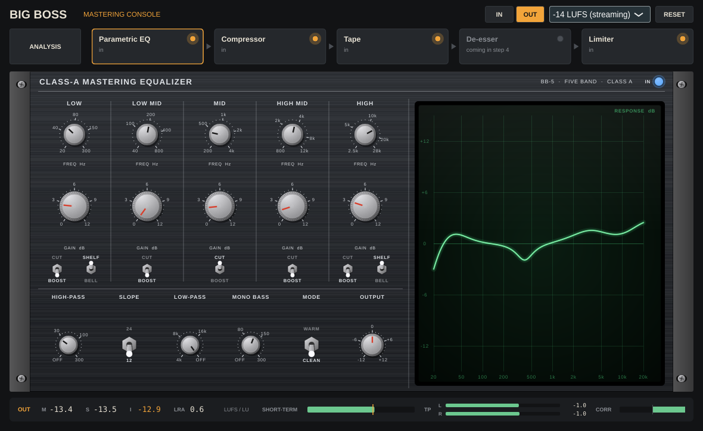
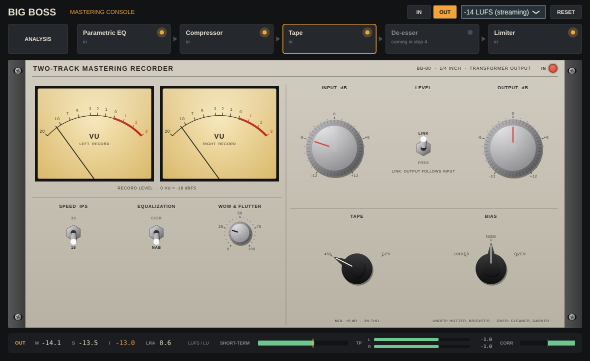
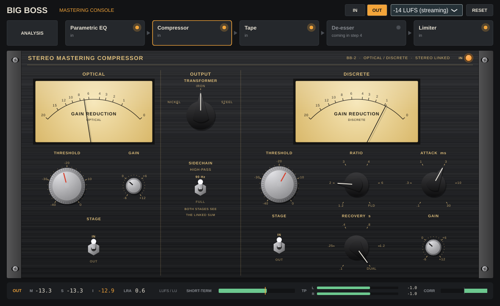
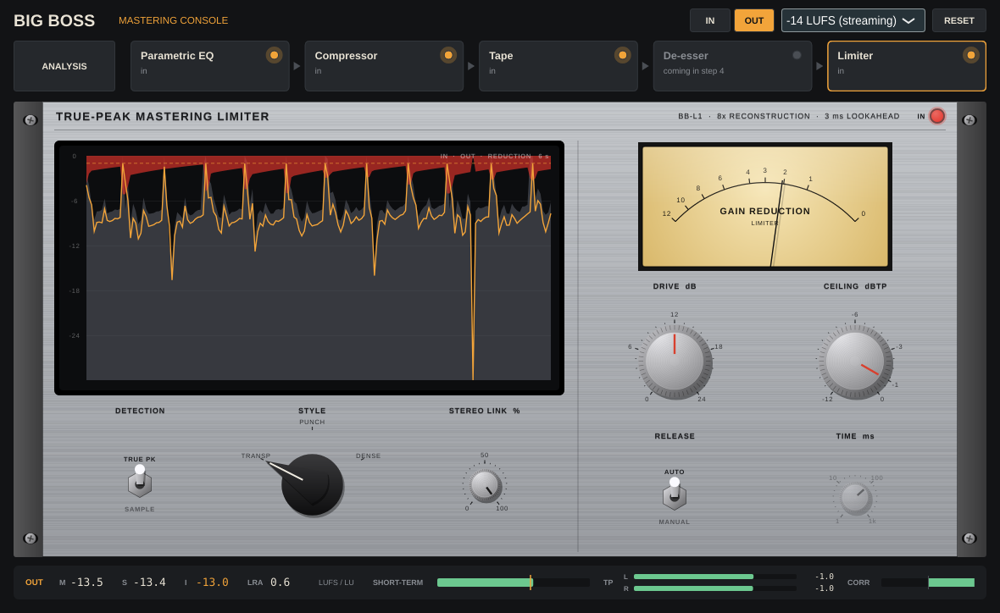

# Big Boss Mastering Console

A mastering console as one VST3: detailed loudness and level metering, and a chain modelled on mastering hardware rather than on other plugins.

The console opens on the **ANALYSIS** dashboard. The chain strip doubles as the tabs: click a module to show it as a rack unit, with a slim loudness and peak strip under it so levels stay in view, and click **ANALYSIS** to go back.










## Plan

| Step | What | State |
|---|---|---|
| 1 | Foundation and metering: project, chain host, meters | done |
| 2 | Elysia museq-style mastering parametric, filters, Studer A80 tape; rack tabs | done |
| 3 | Shadow Hills-style mastering compressor; our own limiter, scored against FabFilter Pro-L 2 | this version |
| 4 | A new multiband de-esser; the full console UI | next |

None of the hardware has public schematics, so the models are voiced from published specs, manuals and measurements of the units. Each module's notes will say which.

## The chain

Five slots: **Parametric EQ, Compressor, Tape, De-esser, Limiter**. Click a module to open its rack unit, drag it to reorder it, click its lamp (or the IN lamp on its rack unit) to bypass it. The EQ, Compressor, Tape and Limiter are built; the De-esser slot passes audio through untouched until step 4.

- **Latency never changes.** It is the sum of every module's latency, whatever is bypassed or reordered, so the host's delay compensation stays put. A bypassed module's dry path is delayed by the same amount.
- **Bypass is a 10 ms crossfade**, and bypassed modules keep running, so switching one back in is seamless.
- **Reordering mutes for about 10 ms** (fade out, switch, let the old audio clear, fade in) rather than glitching.
- **Input and Output trims** sit either side of the chain (±24 dB).
- The host's own bypass delays the dry signal by the chain's latency, so A/B against the host bypass stays time-aligned.

## Class-A EQ

Five bands in the manner of the elysia museq. Each gain knob goes one way (0 to 12 dB) and its **BOOST/CUT** switch gives it a direction and a shape: boosts are broad and gentle, cuts narrower, as on the hardware. LOW and HIGH switch between **SHELF** and **BELL**.

| Band | Range | Default |
|---|---|---|
| LOW | 20–300 Hz | 60 Hz, shelf |
| LOW MID | 40–800 Hz | 200 Hz |
| MID | 200 Hz–4 kHz | 1 kHz |
| HIGH MID | 800 Hz–12 kHz | 4 kHz |
| HIGH | 2.5–28 kHz | 12 kHz, shelf |

- **HIGH-PASS** 10–300 Hz at 12 or 24 dB/oct, **LOW-PASS** 4–30 kHz at 12 dB/oct, and **MONO BASS** 40–300 Hz, which high-passes only the side signal (24 dB/oct). Each has an OFF position at the end of its travel.
- **WARM** broadens the boosts a little and adds the class-A stage's low-order harmonics (mostly 2nd, about 0.1% at 0 VU and rising with level).
- Everything runs oversampled to 176.4 kHz or more, so bells and shelves keep their analogue shape up to 20 kHz. Knobs glide over 20 ms; a switch fades its band to 0 dB, changes shape and fades back, so nothing clicks.
- The phosphor scope draws the response from the same filter design the audio runs; the audio matches the drawn curve within 0.1 dB.

## Tape machine

A two-track mastering recorder in the manner of the Studer A80.

- **SPEED** 15 or 30 ips. **EQUALIZATION** NAB or CCIR at 15 ips; 30 ips is always AES.
- **TAPE**: a 456-type formulation (MOL +8 dB over 0 VU) or a GP9-type (+12 dB). **BIAS**: under (hotter, brighter), nominal, or over (cleaner, darker).
- **INPUT** sets the record level: 0 dB puts −18 dBFS RMS at 0 VU. **LINK** makes **OUTPUT** follow input inversely, so INPUT changes the drive but not the level.
- **WOW & FLUTTER**, 0–100% of the A80's specified maximum (default 25%).
- Signal path: record pre-emphasis, Jiles–Atherton tape hysteresis and its exact de-emphasis (all oversampled), then the playback head's response (head bump, low-end roll-off, gap loss and bias's HF tilt) and the transport. The drive is calibrated so 3% THD at 1 kHz falls at each tape's MOL; at 0 VU the 456 reads about 0.55% THD and the GP9 about 0.25%. Switch changes crossfade between two fully threaded paths over 30 ms.
- The VU meters show record level with VU ballistics.

The responses are voiced from published A80 specifications and plots, not measured from a machine.

## Compressor

A two-stage stereo mastering compressor in the manner of the Shadow Hills Mastering Compressor. Both stages are always stereo-linked.

- **OPTICAL**: threshold and gain. It is a gentle, wide-kneed stage, about 3:1 well above threshold, and its release depends on its history like a photocell's. It lets go of a short burst in about 60 ms, but after it has been held down for a while the release slows toward 1.5 s.
- **DISCRETE**: threshold and gain. It is fed from the optical stage's output and has these selectors:
  - **RATIO**: 1.2:1, 2:1, 3:1, 4:1, 6:1 or FLOOD.
  - **ATTACK**: 0.1 to 30 ms, in six steps.
  - **RECOVERY**: 0.1 to 1.2 s, or DUAL. DUAL recovers fast from peaks and slowly from sustained compression.
- **OUTPUT TRANSFORMER**: NICKEL is close to a wire. IRON adds low-frequency 2nd harmonic. STEEL adds low-frequency 3rd harmonic and weight. Only the lows saturate, so the top end stays clean.
- **SIDECHAIN HIGH-PASS** at 90 Hz, so the kick and bass do not drive the compression.
- Each stage has its own gain-reduction meter.

The behaviour is voiced from the unit's manual and published descriptions, not measured from one.

## Limiter

Our own design: a true-peak mastering limiter.

- **DRIVE** 0 to 24 dB into a **CEILING** of 0 to −12 dBTP.
- **TRUE PEAK** detection reconstructs the signal at 8x below 88.2 kHz (4x below 176.4 kHz, 2x above) with a 32-tap-per-phase sinc, and refines each crest with a parabola. Overs between samples are therefore caught before they happen, and the ceiling holds after any D/A or codec. **SAMPLE** mode limits sample peaks only.
- The gain can never let an over through. It comes from the minimum required gain over a 3 ms lookahead, then a hold and a two-speed release, then one or two moving averages no longer than the lookahead. Every stage can only lower the gain, so the result is at or below the required gain at every sample.
- The hold spans a bass note's half cycle, so a sustained low note gets a steady gain instead of one that ripples at the note's frequency. A ripple like that is the usual cause of a limiter's low-frequency distortion.
- **STYLE**: TRANSPARENT (smooth S-curve attack, long hold and release), PUNCH, or DENSE (short hold, fast release, louder). Switching style crossfades the gains, which is safe because every style's gain is under the required gain.
- **RELEASE**: AUTO (two-speed and programme dependent), or MANUAL from 1 ms to 1 s. **STEREO LINK** from 0 to 100%.
- Latency is 3 ms plus 16 samples. Below the ceiling it is a pure delay, bit for bit.
- The display shows six seconds of input, output and gain reduction, next to a gain-reduction meter.

Measured here, with the −1 dBTP ceiling and 6 dB of reduction on a steady sine (THD+N, 48 kHz, from `bb_dynamics_tests`):

| Style | 30 Hz | 50 Hz | 100 Hz | 1 kHz |
|---|---|---|---|---|
| Transparent | <0.0001% | <0.0001% | <0.0001% | <0.0001% |
| Punch | 0.10% | <0.0001% | <0.0001% | <0.0001% |
| Dense | 1.06% | 0.11% | <0.0001% | <0.0001% |

True peak stays at or under the ceiling, within the meter's 0.05 dB, at every rate and style tested: on a hot programme driven 12 dB, on a 19 kHz tone, and while switching styles mid-limit. These are our own measurements; there has been no side-by-side test against Pro-L 2 here.

## Metering

Switch the meters between **IN** (the signal arriving, before the input trim) and **OUT** (what leaves the console). **RESET** restarts integrated loudness, LRA, the maxima and the peak holds.

| Reading | How it is measured |
|---|---|
| Momentary, short-term, integrated | ITU-R BS.1770-4 / EBU R128: K-weighting re-derived for every sample rate, 400 ms and 3 s windows, absolute (−70 LUFS) and relative (−10 LU) gates |
| LRA | EBU Tech 3342: short-term values, −20 LU relative gate, 10th to 95th percentile |
| True peak | 4x oversampling below 88.2 kHz and 2x below 176.4 kHz, with a 32-tap-per-phase Kaiser sinc, and each crest refined with a parabola. Within 0.05 dB up to 20 kHz at 44.1 kHz; plain 4x under-reads a 20 kHz tone there by up to 0.2 dB |
| PLR | Highest true peak minus integrated loudness |
| Max S, Max M | Highest short-term and momentary since reset |
| Sample peak | Highest sample, since reset |
| Correlation, balance, S/M | Integrated over 300 ms, like a hardware correlation meter |
| Spectrum | Mid (amber, with a slow peak trace) and side (blue), 8192-point FFT, tilted 4.5 dB/oct around 1 kHz so pink noise reads flat |
| Stereo field | Goniometer with auto-gain: mono is vertical, out-of-phase is horizontal |
| History | Short-term (amber) and momentary (blue) over the last 60 s, with the integrated value dashed |

The target menu (−9 to −23 LUFS) only moves the reference line on the bars and the history. It never changes the audio.

The engine is real-time safe: nothing allocates or locks on the audio thread, gated loudness uses fixed 0.01 LU histograms (so an hour of programme costs the same as a second), and the editor reads atomics and lock-free rings.

## Building

CMake 3.22+ and a C++17 compiler. JUCE 8.0.15 is fetched automatically; to use a local checkout, add `-DFETCHCONTENT_SOURCE_DIR_JUCE=/path/to/JUCE`.

```sh
cmake -S . -B build -DCMAKE_BUILD_TYPE=Release
cmake --build build --config Release --parallel
ctest --test-dir build -C Release --output-on-failure
```

The VST3 lands in `build/BigBoss_artefacts/Release/VST3/`, next to a Standalone app.

Linux needs: `libasound2-dev libfreetype-dev libfontconfig1-dev libx11-dev libxcomposite-dev libxcursor-dev libxext-dev libxinerama-dev libxrandr-dev libxrender-dev libgl1-mesa-dev`.

### Tests

- `bb_engine_tests`: K-weighting against the BS.1770 coefficient table; EBU Tech 3341 cases 1–5 (M, S and I, gating) and 15–19 (true peak); Tech 3342 cases 1–4 (LRA), all at 44.1, 48, 96 and 192 kHz; the 20 kHz true-peak accuracy; block-size independence; correlation; the chain's latency, bypass and reorder behaviour; and the tape slot's reported latency, measured by cross-correlation.
- `bb_module_tests`: the EQ is flat when idle, its audio matches the drawn curve within 0.1 dB, boosts are broader than cuts, and the high-pass, mono bass, Warm's 2nd harmonic, click-free switching and reported latency all check out. The tape machine puts 3% THD at each tape's MOL, has unity small-signal gain, reports its true latency, distorts more on 456 than GP9 and more under-biased than over, holds more top end at 30 ips, has its head bump, keeps wow and flutter within spec, switches without clicks, and keeps level constant under Link. Each at several sample rates.
- `bb_dynamics_tests`: the compressor's static curve, attack ordering, the optical stage's history-dependent release, the transformers' harmonics and the sidechain filter. The limiter's ceiling (sample and true peak) on a driven programme at 44.1, 48 and 96 kHz in every style, a 19 kHz tone, style switching under load, bit-exact transparency below the ceiling, its reported latency and stereo link. It also prints the distortion table above.
- `bb_fuzz [seconds]`: random rates, block sizes, extreme signals, bypass and order changes, and random EQ, compressor, tape and limiter settings through the chain and both meter suites; fails on any non-finite value.
- pluginval at strictness 10: `pluginval --strictness-level 10 --validate-in-process "build/BigBoss_artefacts/Release/VST3/Big Boss Mastering Console.vst3"` (on Linux, under `xvfb-run -a`).
- `-DBB_BUILD_SNAPSHOT=ON` builds `bb_snapshot out.png [seconds]`, which runs a synthetic mix through the console and renders the dashboard and every module to PNGs (`out.png`, `out-eq.png`, `out-tape.png` and so on; the screenshots above).

GitHub Actions (`.github/workflows/build.yml`) runs **only when started by hand**: Actions → Build → Run workflow (Windows, or all platforms). It never runs on push or on pull requests.

## Code map

| Path | What |
|---|---|
| `src/meter/` | Loudness (`LoudnessMeter`), true peak (`TruePeak`), stereo (`StereoMeter`) and the bundle the plugin uses (`MeterSuite`). No JUCE |
| `src/chain/` | `Module` interface, `Chain` (order, bypass, latency), `EqModule`, `CompModule`, `TapeModule`, `LimitModule`. No JUCE |
| `src/eq/` | `EqDesign` (band shapes, shared with the editor's scope) and `ClassAEq`. No JUCE |
| `src/tape/` | `TapeMachine`. No JUCE |
| `src/dyn/` | `DualCompressor` and `Limiter`. No JUCE |
| `src/dsp/` | Shared with mingusdynasty/chocolatefudgeverb, copied at `6edfcdc` (namespace `cf`): tape heads and Jiles–Atherton hysteresis, Hot Sauce saturator, tube and transformer stages, half-band filters, level match. Keep changes in step with that repo. `Oversampler` is ours |
| `src/plugin/` | JUCE processor and editor; `Params` (parameter ids and ranges); `ui/` holds the look, meter panel and strip, spectrum and goniometer, chain strip, and the rack (`Rack`, `RackControls`, `EqUnit`, `CompUnit`, `TapeUnit`, `LimitUnit`) |
| `tests/`, `tools/snapshot/` | Engine tests, fuzzer, UI snapshot tool |

Personal use. JUCE is AGPLv3 unless you hold a commercial licence.
